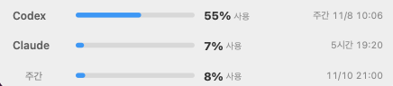

# KakaoBannerHider (카톡 배너 가리기)

맥 카카오톡 창 맨 아래에 생긴 **광고 배너 자리**를, 카카오톡 앱은 건드리지 않고
화면에서 가려 주는 메뉴 막대 앱입니다. 가린 자리에는 **Codex · Claude 한도 사용량**을
두 줄로 띄우거나, 시계·문구를 넣거나, 그냥 비워 둘 수 있습니다.



- 카카오톡 앱 파일, 코드 서명, 설정, 대화 내용을 **수정하지 않습니다.**
- 광고 자리를 읽기만 해서(Accessibility) 그 위에 같은 색 판을 덮습니다.
- 앱을 **종료하면 즉시** 원래 화면으로 돌아옵니다.

## 특징

| 항목 | 내용 |
|---|---|
| 하단 배너 가리기 | 빈 공간 / 시계 / 내 문구 / **Codex·Claude 한도 사용량** |
| 한도 표시 | 공급자별 게이지. 두 번째 창(Claude 주간 등)은 아래 줄에 따로 |
| 배경색 자동 맞춤 | 카카오톡 창을 한 장 찍어 배너 영역의 대표색을 뽑아 칠함 (라이트/다크 모두) |
| 창 따라가기 | 창을 옮기거나 크기를 바꾸면 0.2초 주기로 따라감 |
| 가려짐 감지 | 카카오톡 창이 다른 창 뒤로 가면 덮개도 같이 숨김 |
| 안전장치 | 배너 자리를 못 재면 **아무것도 하지 않음** (목록을 잘못 가리지 않음) |
| 되돌리기 | 메뉴 → 종료. 흔적 남기지 않음 |

## 요구 사항

- macOS 13 이상 (Apple Silicon 확인, Intel은 빌드만 되고 미확인)
- Xcode 명령줄 도구 (`swiftc`)
- **손쉬운 사용** 권한 — 창 위치/크기 읽기
- (선택) **화면 기록** 권한 — 배경색 자동 맞춤. 없으면 밝은/어두운 기본색 사용

## 설치

```bash
git clone git@github.com:bear2u/KakaoBannerHider.git
cd KakaoBannerHider
./install.sh        # 빌드 → /Applications 설치 → Launchpad 등록 → 실행
```

`install.sh`가 빌드부터 설치·등록·실행까지 한 번에 합니다. /Applications에 복사되므로
Launchpad(응용 프로그램)에서 `KakaoBannerHider`를 클릭해 실행할 수 있습니다.

| 명령 | 동작 |
|---|---|
| `./install.sh` | 빌드 + 설치 + 등록 + 실행 |
| `./install.sh --no-build` | 이미 빌드된 앱만 설치 (코드 해시가 유지돼 권한 재승인 불필요) |
| `./install.sh --no-launch` | 설치만 |
| `./install.sh --uninstall` | 앱 + 설정 제거 |

처음 실행하면 손쉬운 사용 권한을 물어봅니다.
**시스템 설정 → 개인정보 보호 및 보안 → 손쉬운 사용**에서 허용해 주세요.
(새로 빌드하면 앱 코드 해시가 바뀌므로 권한을 한 번 다시 허용해야 합니다.)

## 사용

메뉴 막대의 `AD`(빗금) 아이콘을 누르면:

- **광고 가리기** — 켜고 끄기
- **가린 자리에 표시**
  - `Codex · Claude 한도 사용량` (기본)
  - `아무것도 없이 (빈 공간)`
  - `시계`
  - `내 문구` — 문구 바꾸기…로 편집
- **한도 지금 새로고침** — 5분 주기를 기다리지 않고 갱신
- **로그인할 때 자동 실행**
- **카카오톡 앞으로 가져오기**
- **종료 (광고 원래대로)**

## 한도 사용량은 어디서 오나

5분마다 [`Scripts/usage_fetcher.py`](Scripts/usage_fetcher.py)를 실행해 두 곳에서 **읽기만** 합니다.

| 대상 | 자격 증명 위치 | 엔드포인트 |
|---|---|---|
| Claude Code | 키체인 `Claude Code-credentials` | `api.anthropic.com/api/oauth/usage` |
| Codex | `~/.codex/auth.json` | `chatgpt.com/backend-api/wham/usage` |

- 토큰을 **갱신하지 않습니다**(CLI가 스스로 갱신). 만료되면 `갱신 필요`로 표시되고,
  `claude` / `codex`를 한 번 실행하면 다시 채워집니다.
- 공급자마다 한 줄, 두 번째 창(예: Claude 주간)은 그 아래에 한 줄 더 표시합니다.
  (Codex 1줄 + Claude 5시간·주간 2줄 = 최대 4줄까지)
- 게이지는 **쓴 만큼** 채워집니다(0% = 한도 그대로, 100% = 소진).
- 사용 65% 이상이면 주황, 85% 이상이면 빨강.

## 동작 원리

1. Accessibility로 카카오톡 메인 창과, 채팅/친구 목록을 담은 스크롤 영역의 **아랫변**을 읽습니다.
   그 아래부터 창 바닥까지가 배너 자리입니다(카카오톡 26.9.0 기준 101pt).
2. 그 영역에 테두리 없는 패널을 띄웁니다. 창을 한 장 찍어 배너 영역에서 가장 많이 쓰인 색을
   뽑아 칠하고, 아래 모서리는 창과 같은 곡률로 깎습니다.
3. 0.2초마다 창 위치·크기·가려짐을 확인해서 패널을 맞춥니다.

광고를 "지우는" 게 아니라 "가리는" 방식이라, 카카오톡이 광고를 그리는 동작 자체는 그대로입니다.

## 파일 구조

```
KakaoBannerHider/
├── Sources/main.swift          앱 전체 (메뉴 막대 · AX 측정 · 덮개 패널 · 한도 뷰)
├── Scripts/usage_fetcher.py    Codex/Claude 한도 조회 (표준 라이브러리만 사용)
├── build.sh                    swiftc 빌드 → 앱 번들 → 애드혹 서명
├── install.sh                  빌드 · 설치 · 등록 · 실행 · 제거
├── docs/usage-band.png         README 스크린샷
└── LICENSE
```

## 개발 메모

- 외부 의존성 없음. AppKit + ApplicationServices 만 씁니다. (Swift 단일 파일)
- 화면 읽기는 세 가지: `AXUIElement`(창·목록 위치), `CGWindowListCopyWindowInfo`(가려짐 판정),
  `CGWindowListCreateImage`(배경색 샘플, dlsym으로 호출).
- 주기: 창 추적 0.2초, 한도 조회 5분.
- 빌드 산출물(`.build/`, `KakaoBannerHider.app`)은 `.gitignore`로 제외합니다.

손대기 쉬운 지점:

| 무엇 | 어디 |
|---|---|
| 창 추적 주기 | `tickTimer` (main.swift) |
| 한도 조회 주기 | `startUsageLoop()` 의 300초 |
| 덮개 모서리 곡률 | `BandView.bottomRadius` |
| 게이지 색 기준 | `UsageView.accent(for:)` |

## 한계

- 덮개가 그 자리의 클릭을 받습니다. 광고를 잘못 눌러 페이지가 열리는 일은 없지만,
  **창 아래쪽 모서리를 잡고 크기 조절**하는 건 덮개에 막힙니다(옆/위 모서리로 조절).
- 광고 요청·노출 집계는 계속 나갑니다. 그것까지 막으려면 `/etc/hosts` 차단이 필요합니다(관리자 권한).
- 맥 카카오톡은 배너 자리가 창 레이아웃에 고정돼 있어서, **목록을 그만큼 길게** 만들 수는 없습니다.
  그렇게 하려면 앱을 패치해야 하고, 서명이 깨져 업데이트마다 다시 손봐야 합니다.
- 카카오톡이 배너 자리 구조를 크게 바꾸면 동작하지 않을 수 있습니다. 그때는 아무것도 하지 않습니다.

## 문제 해결

| 증상 | 확인 |
|---|---|
| 메뉴 막대에 `AD` 아이콘이 없어요 | 앱이 실행 중인지 확인. 메뉴 막대가 꽉 차 있으면 다른 아이콘에 가려질 수 있습니다 |
| 아이콘은 있는데 배너가 그대로예요 | ① 손쉬운 사용 권한 ② 카카오톡 창이 **앞에** 있는지(뒤에 있으면 일부러 숨깁니다) ③ 카카오톡 재시작 |
| 덮개가 잠깐 늦게 떠요 | 창을 띄운 직후 최대 0.2초까지 걸립니다 |
| 덮개 색이 배경과 달라요 | 화면 기록 권한이 없으면 밝은/어두운 기본색을 씁니다 |
| 아래 모서리로 창 크기를 못 줄여요 | 덮개가 그 자리 클릭을 받기 때문입니다. 옆/위 모서리로 조절하세요 |
| 한도가 `갱신 필요`로 떠요 | `claude` / `codex`를 한 번 실행한 뒤 메뉴 → **한도 지금 새로고침** |
| 카카오톡 업데이트 후 안 돼요 | 배너 자리를 못 재면 아무것도 하지 않습니다. 이슈로 알려 주세요 |
| 여러 모니터·스페이스 | 창이 실제로 보이는 곳에서만 덮개가 뜹니다 |
| 새로 빌드하니 권한을 또 물어봐요 | 코드 해시가 바뀌어서입니다. `./install.sh --no-build` 로 설치하면 유지됩니다 |

## 개인정보

- 수집·전송하는 데이터가 없습니다. 분석 도구도 없습니다.
- 토큰은 **읽기만** 하고, 저장하거나 외부로 보내지 않습니다. 한도 조회 요청은 각 공급자의 공식
  엔드포인트로만 나갑니다.
- 설정은 `~/Library/Preferences/io.github.bear2u.kakaobannerhider.plist` 한 곳에만 저장됩니다.

## 제거

```bash
./install.sh --uninstall      # 앱 + 설정 + 등록 정보 제거
```

수동으로 지우려면 메뉴 → **종료** 후 `KakaoBannerHider.app`을 휴지통으로 옮기고,
`~/Library/Preferences/io.github.bear2u.kakaobannerhider.plist`를 삭제하면 됩니다.

## 확인 환경

- 2026-11-04, macOS 26.6.2 (25G83), Apple Silicon
- 카카오톡 26.9.0
- Codex CLI / Claude Code 로그인 상태
- Intel Mac은 빌드만 되고 동작은 확인하지 않았습니다.

## 변경 내역

### v1.1 — 2026-11-05
- 게이지를 **사용한 만큼** 채우도록 변경, 숫자도 `사용` 기준
- Claude 주간 한도를 5시간 게이지 아래 줄로 분리

### v1.0 — 2026-11-04
- 첫 릴리스: 하단 배너 가리기, 표시 모드 4종(한도 사용량 / 빈 공간 / 시계 / 내 문구)
- 배경색 자동 맞춤, 창 이동·크기 변경 추적, 가려짐 감지
- Codex · Claude 한도 사용량 두 줄 표시 (5분 주기, 게이지는 사용한 만큼)
- `install.sh`: 빌드 → /Applications 설치 → Launchpad 등록 → 실행

## 라이선스

MIT — [LICENSE](LICENSE)

카카오와 관계없는 비공식 도구입니다. "카카오톡"은 대상 앱을 가리키는 용도로만 씁니다.
사용에 따른 책임은 사용자에게 있습니다.
